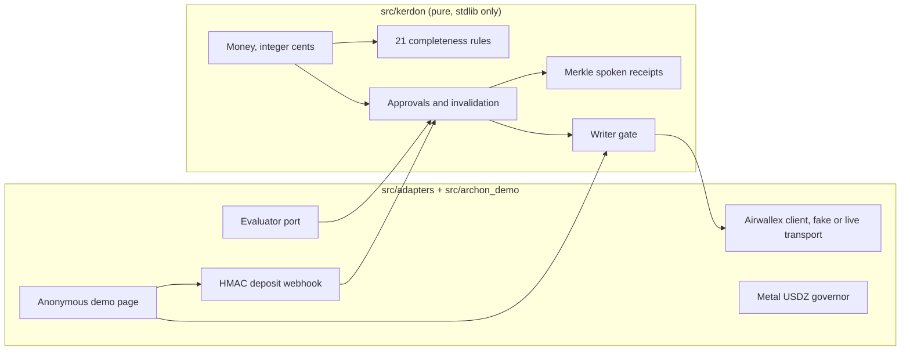
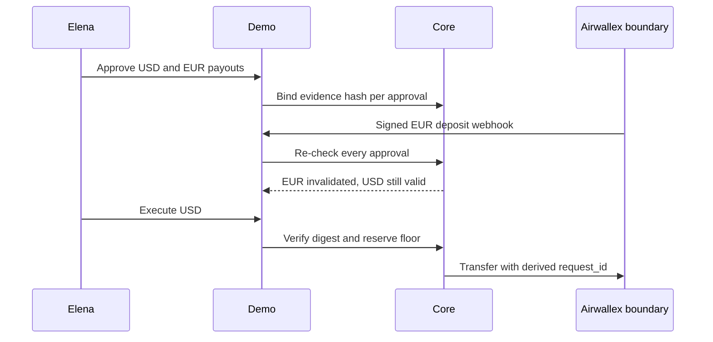

# Archon Treasury (powered by Kerdon)

[](https://github.com/upgradedev/archon-treasury-aws/actions/workflows/ci.yml)
[](https://github.com/upgradedev/archon-treasury-aws/actions/workflows/codeql.yml)
[](LICENSE)

Archon Treasury recalculates Airwallex FX and supplier payouts when a deposit lands, invalidating stale approvals so cross-border teams never breach their cash reserve floor.

For Elena Vance, Finance and Operations Manager at a 14-person cross-border hardware studio, who approves supplier payouts in USD, EUR, and GBP without a full-time controller. The approval card lives where she already works. A signed Airwallex deposit webhook fires the recalculation without anyone asking. It replaces the three-tab spreadsheet she juggles before every wire batch.

Status, stated plainly: the anonymous demo is live at https://pjlgavqdkhrcserxuqjz6icit40vbfxv.lambda-url.eu-west-1.on.aws/ (AWS Lambda, `eu-west-1`). It uses synthetic data on a fake transport and says so on its own page. Live Airwallex sandbox wiring is coded behind an injected transport and activates with sandbox credentials (not yet connected). Verify the live journey any time with `python scripts/smoke_deployed.py <base-url>` and match the build at `GET /DEPLOYED_SHA`.

## Contents

- [Quickstart](#quickstart)
- [What happens in the demo](#what-happens-in-the-demo)
- [Architecture](#architecture)
- [Measured numbers](#measured-numbers)
- [Repository layout](#repository-layout)
- [Security and privacy notes](#security-and-privacy-notes)
- [Standards mapping](#standards-mapping)
- [License](#license)

## Quickstart

Prerequisites: Python 3.11 or newer. There is nothing to install; the runtime is the standard library only. Honest time to first result: under one minute.

```powershell
# Windows PowerShell, from the repo root
$env:PYTHONPATH='src'; python -m unittest discover -s tests
# Expected: Ran 111 tests ... OK
python scripts/verify_gates.py --self-test
# Expected: RESULT: PASS auto-gates=10 failed=none (offline; live URL is smoked separately)
python scripts/run_benchmark.py
# Expected JSON: "engine_accuracy": "74/74", "baseline_accuracy": "24/74"
$env:PYTHONPATH='src'; python -m archon_demo.server --port 8765
# Then open http://127.0.0.1:8765/ in a browser. No login.
```

```bash
# Linux or macOS
PYTHONPATH=src python -m unittest discover -s tests
PYTHONPATH=src python scripts/verify_gates.py --self-test
PYTHONPATH=src python -m archon_demo.server --port 8765
```

CI runs the same two commands on Python 3.11 and 3.12 (`.github/workflows/ci.yml`) and deploys to AWS Lambda on pushes to `main`.

## What happens in the demo

1. Approve a USD payout and a EUR payout. Each approval binds the amount, currency, counterparty, FX quote, terms hash, and a SHA-256 hash of the exact evidence behind it. You get a spoken receipt sealed with a Merkle root.
2. Land a EUR deposit. The webhook handler verifies its HMAC signature, credits the balance, and re-checks every approval. Only the EUR approval falls, because only its evidence changed.
3. Execute the USD payout. It pays. Try the stale EUR one. The Writer gate refuses it and the page shows the reason next to the button.
4. Read the completeness findings. Twenty-one deterministic rules answer one question: what is missing?

## Architecture





Three roles hold three separate powers. Reader can look. Evaluator can parse a document and propose a typed intent. Writer can move money, and only through a gate that demands a fresh approval digest and a reserve floor check. A test proves a Reader credential attempting a write is refused before any adapter runs.

Money is integer cents everywhere inside. The one file allowed to turn cents into major-unit decimal strings for the Airwallex boundary is `src/adapters/airwallex_client.py`, because that API treats `100` as 100.00. Request IDs are derived as `uuid5(namespace, operation hash)`, so an exact retry reuses its ID and a revised decision gets a fresh one.

## Measured numbers

Every number below names the command that produces it. Run them; do not take this file's word for them.

| Claim | Value | Command |
|---|---|---|
| Unit, UAT, and integration tests | 111 passing, 0 failures | `PYTHONPATH=src python -m unittest discover -s tests` |
| Hosted model alone, same 62 rule cases | 28 of 62 (Claude Haiku on Bedrock, one pass) | `PYTHONPATH=src python scripts/run_llm_benchmark.py` with AWS credentials |
| Line coverage, pure core / demo / adapters | 95% (876/915), 94% (654/694), 87% (469/537) | `python scripts/coverage_check.py 85` |
| Live judge journey | 38 of 38 smoke steps pass | `python scripts/smoke_deployed.py https://pjlgavqdkhrcserxuqjz6icit40vbfxv.lambda-url.eu-west-1.on.aws/` |
| Accessibility audit | 0 axe-core violations at 375px and 1280px | axe-core 4.10.2 injected over DevTools on the live URL, 2026-11-05 |
| Offline gates | 10 of 10 pass | `python scripts/verify_gates.py --self-test` |
| Frozen benchmark, deterministic engine | 74 of 74 cases | `PYTHONPATH=src python scripts/run_benchmark.py` |
| Frozen benchmark, naive one-pass matcher | 24 of 74 cases | same command; baseline kind is printed in its output |
| Benchmark wall time | single-digit milliseconds on this repo's CI class runners; printed per run | same command, `elapsed_ms` field |
| Pure core size ceiling | largest core file 311 lines | gate A1 in `scripts/verify_gates.py` |

Benchmark method, so it can be challenged: each of the 74 cases is labelled before any engine runs. A broken case scores when its labelled rule or invalidation verdict is detected; a clean case scores when zero blockers fire. The baseline is a naive amount matcher coded in the benchmark script. It is not a hosted language model measurement, and the script prints that fact.

## Repository layout

- `src/kerdon/` pure domain: money, models, completeness, approvals, receipts, ports. Imports no cloud or model SDK; gate A5 proves it.
- `src/adapters/` Airwallex boundary and fake transport, live HTTP transport, HMAC webhook, Metal USDZ governor, Evaluator stand-in.
- `src/archon_demo/` anonymous demo service, stdlib server, accessible page, Lambda handler.
- `tests/`, `scripts/` (gates, benchmarks, packaging, live smoke), `infra/` (Terraform mirroring the deployed Lambda), `docs/` (submission text, video script, form fields).

## Security and privacy notes

The demo processes synthetic records only. No personal data is collected, stored, or sent anywhere; `grep -ri "supplier-a" src/` shows the invented fixture names. Credentials for the live transport come from `AWX_CLIENT_ID` and `AWX_API_KEY` environment variables and construction fails closed without them. Webhooks require a valid HMAC-SHA256 signature before any state changes. The public read identity holds no write capability by construction, not by convention.

Known limits, named by input: amounts with more than two decimal places are refused at the boundary. Currencies outside USD, EUR, GBP, and USDZ are refused in the core. An invoice the extractor reads differently from its obligation produces a refusal, never a guess. Demo sessions live in memory per visitor and per container, so a cold start reseeds the scenario.

## Standards mapping

AWS Well-Architected, one row per pillar. Control references point at the public pillar names; read them as design intent for a hackathon build, not as an audit result.

| Pillar | What this repo does | Residual gap |
|---|---|---|
| Operational Excellence | One gate command runs tests, benchmark, and hygiene in CI | No runbooks or alarms yet |
| Security | Least-privilege roles, HMAC webhooks, content-addressed approvals, secret scan gate | Live IAM policies ship with the first deploy |
| Reliability | Deterministic re-checks, idempotent request IDs, fail-closed gates | No multi-region story; demo state is in memory |
| Performance Efficiency | Integer math, 74-case benchmark in milliseconds, 256 MB Lambda | No sustained load test yet; cold start about 1 second measured once |
| Cost Optimization | Stdlib runtime on pay-per-request Lambda, no provisioned concurrency | Exact monthly bill unmeasured; check Cost Explorer after judging |
| Sustainability | Tiny always-warm footprint for the demo window | No carbon accounting |

EU AI Act (Regulation EU 2024/1689), articles 10, 13, 14, 15, and 50.

| Article | What this repo does | Residual gap |
|---|---|---|
| 10, data | Synthetic fixtures only; evidence hashes bind inputs to decisions | Production data governance is future work |
| 13, transparency | Every approval shows its evidence digest and spoken receipt | Model-backed evaluator adds its own disclosure duty |
| 14, human oversight | A human approves an exact hash; stale approvals cannot execute | Override path is re-approval only, by design |
| 15, accuracy | Frozen benchmark with a labelled baseline, bound in CI | Live-data accuracy unmeasured |
| 50, disclosure | The demo page labels synthetic mode on its face | Production surfaces need the same label discipline |

## License

MIT. See `LICENSE`.
